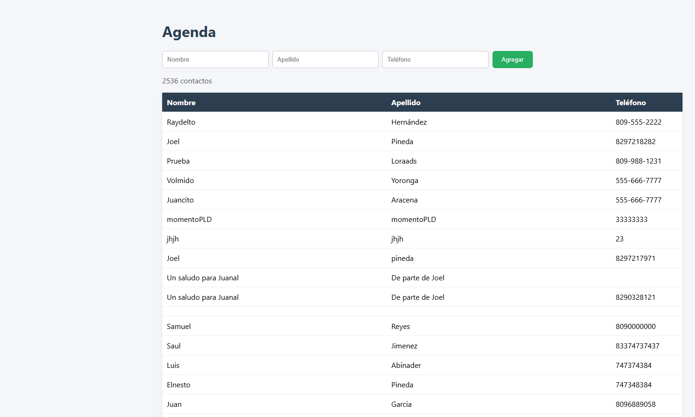
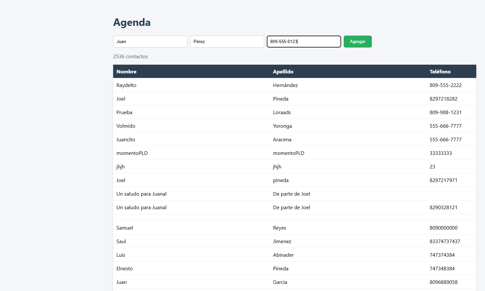
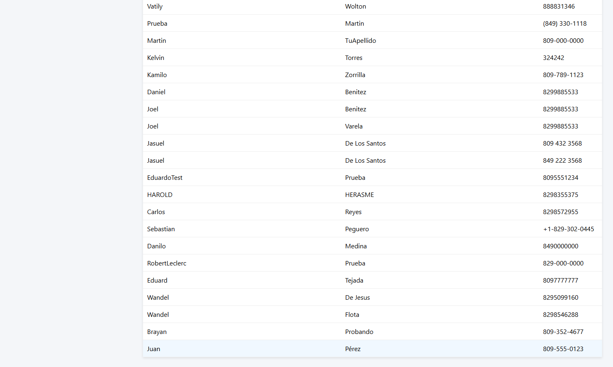

# Tarea 3: Agenda Multicapas

Programación WEB – ITLA (2026-C-003)

**Estudiante:** Jezel Erislander Pujols Batista · **Matrícula:** 2025-2067 · **Carrera:** Desarrollo de Software

Agenda WEB que lista y agrega contactos (nombre, apellido, teléfono) usando `fetch` contra `http://www.raydelto.org/agenda.php` (GET para listar, POST con JSON para agregar).

Abrir `index.html` en el navegador (desde archivo local o un servidor `http://`, no `https://`, porque el servicio es HTTP).

## Capturas de pantalla

La agenda carga con `GET` el listado de `agenda.php` y muestra el total de contactos en la tabla.

Formulario relleno con un contacto de ejemplo (Juan Pérez, 809-555-0123), listo para pulsar **Agregar**.

Después de **Agregar**, la app vuelve a cargar el listado y el nuevo contacto aparece en la última fila. En esta captura el `POST` se simuló localmente para no escribir datos de prueba en la agenda pública compartida.
